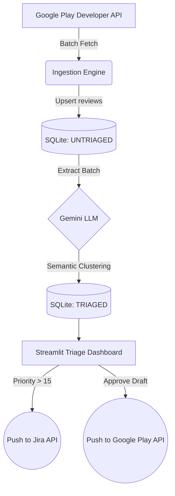

# ReviewPulse AI

[](https://opensource.org/licenses/MIT)
[](https://www.python.org/downloads/)
[](https://streamlit.io)

**An open-source, local-first Play Store review triage engine. Clusters feedback, calculates priority scores, and drafts replies with Gemini, and pushes high-priority clusters to Jira.**


Stop manually reading spreadsheets of app reviews. ReviewPulse AI automatically clusters Google Play feedback, ranks bugs by their impact on your store rating (Rating Drag), and drafts empathetic responses using Gemini. Your triage data stays on your machine; Gemini sees the review fields listed in SECURITY.md, never reviewer names.

---

## ⚡ The 30-Second Demo (No API Keys Required)

Want to see how it works without setting up Google Play or Gemini keys? The demo seeds mock reviews, clusters them with a local keyword matcher in place of Gemini, and runs the real priority scoring.

1. Clone the repo and navigate to the directory:
   ```bash
   git clone https://github.com/stonedhawk/review-pulse-AI.git
   cd review-pulse-AI
   ```
2. Run the setup script to create a virtual environment and install dependencies:
   ```bash
   sh setup.sh  # (On Windows, run setup.bat)
   source venv/bin/activate
   ```
3. Run the demo:
   ```bash
   python pulse.py demo
   ```

**Demo output:**
```text
SCORE  REVIEWS  AVG  CLUSTER
 20.0        6  1.2  Crash on Startup
 12.5        5  2.0  Gacha Rates
 12.0        4  1.5  Login / Server
  4.5        3  3.0  Battery / Heat
  0.0        5  5.0  Generic Praise
```

A full report with draft replies is written to `data/demo_output.md`. Demo drafts come from templates; with a key, Gemini writes them.

Then open the dashboard on the demo data with `python pulse.py ui --demo`. Sending replies and Jira tickets are turned off in demo mode. The demo uses its own database (`data/demo.db`), so it never mixes with real reviews.

---

## 📈 Business Impact & KPIs

ReviewPulse AI shifts your mobile game operations from reactive to proactive, delivering measurable impacts:

1. **MTTR (Mean Time to Respond) Reduction:** Groups isolated feedback reports into shared issues, and drafts a Gemini reply for any review in one click, capped at Google Play's 350-character limit.
2. **Engineering Velocity Optimization (Rating Drag):** Not all bugs are equal. ReviewPulse quantifies issue severity using the *Rating Drag* algorithm `Priority Score = Cluster Frequency * (Target Store Rating - Average Cluster Rating)`. Clusters scoring above 15 get a Push to Jira button in the dashboard.
3. **Less Manual Triage:** Replaces spreadsheet analysis with a SQLite + LLM pipeline that does the first pass of sorting for you.

---

## Prerequisites

Before running ReviewPulse AI with real data, you'll need:

- **Python 3.11+**
- **Google Play Developer API:** a service account JSON with "Reply to Reviews" permission. [Setup guide](https://developers.google.com/android-publisher/getting_started)
- **Gemini API key:** see the note on free and paid keys in Step 1 below
- **Jira API token** (optional): needed for the Push to Jira button

---

## 🛠️ Production Installation

When you are ready to process real data, you must provide your Google Play and Gemini API credentials.

### Step 1: The Configuration File (`.env`)
1. Rename `.env.example` to `.env`.
2. Fill out the fields:
   - `PLAY_STORE_PACKAGE_NAME`: The ID of your game (e.g., `com.yourcompany.yourgame`).
   - `GEMINI_API_KEY`: A free key from [Google AI Studio](https://aistudio.google.com/app/apikey) is fine for testing with the demo or sample data. For real player reviews, use a key from a Google Cloud project with billing enabled: on the free tier, Google can use your prompts to improve its products, and human reviewers may read them. See the [Gemini API terms](https://ai.google.dev/gemini-api/terms).
   - `GOOGLE_APPLICATION_CREDENTIALS_JSON`: A Service Account JSON from your Google Play Console with "Reply to Reviews" permission. Paste it **on a single line** next to the `=` sign.
   - `JIRA_*`: (Optional) Fill these out to enable the "Push to Jira" button.

### Step 2: Run It

Activate your virtual environment (`source venv/bin/activate`) and use the CLI:

```bash
# 1. Fetch new reviews from Google Play
python pulse.py fetch

# 2. Cluster untriaged reviews using Gemini
python pulse.py process

# 3. Start the UI Dashboard
python pulse.py ui
```

---

## Verify Your Setup

**Quick check (no API keys needed):** Run the demo command after local setup:

```bash
python pulse.py demo
```

This seeds mock reviews into `data/demo.db`, runs the clustering and scoring pipeline locally, and writes a report to `data/demo_output.md`. If you see priority-scored clusters in the output, the core pipeline is working. Run the tests with `python -m unittest`.

**Production check:** After configuring your `.env`, run:

```bash
python pulse.py fetch
```

A successful run prints the number of reviews fetched. If this fails, the most common causes are:
- `GOOGLE_APPLICATION_CREDENTIALS_JSON` is malformed (must be valid JSON on a single line)
- Service account doesn't have Play Developer API enabled in GCP Console

---

## 🏗️ Architecture & Security

ReviewPulse AI fetches and processes reviews in batches, which keeps it within Google Play and Gemini API quotas.



### Security First
- **Credentials in `.env`:** Keys live in `.env`, which is gitignored. The service account JSON is pasted into `.env` and parsed in memory, so there is no separate key file to commit by accident.
- **Local Persistence:** Reviews, clusters and priority scores are stored in a local SQLite WAL database. ReviewPulse has no cloud sync. Data leaves your machine when you send it: review fields to Gemini, approved replies to Google Play, and, when you click Push to Jira, the cluster name, priority score and up to five reviews (reviewer names included) to your Jira project.
- **Privacy Boundary:** Priority scores, your target rating and Jira settings are not included in Gemini prompts. Gemini sees review text, plus star rating and app version when clustering, but not reviewer names. Review text is passed as written, so it can contain personal details players type in, such as names, emails or account IDs. See `SECURITY.md` for the exact fields.

